# Fast SiPM Photodetector

This photodetector is built around the fast output of the onsemi MicroFC-30035 silicon photomultiplier (SiPM).
It combines an adjustable sensor-bias supply, an integrated low-noise amplifier, and an analog temperature sensor for external temperature control.
The detector can measure nanosecond-scale events and achieves single-photon resolution.

<table style="border: none;">
  <tr>
    <td style="text-align:center">
      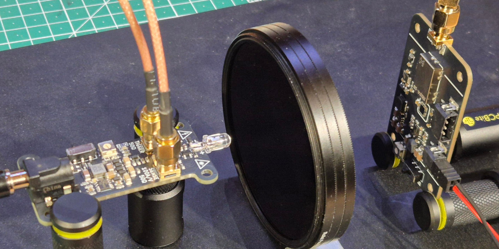 
    </td>
    <td style="text-align:center">
      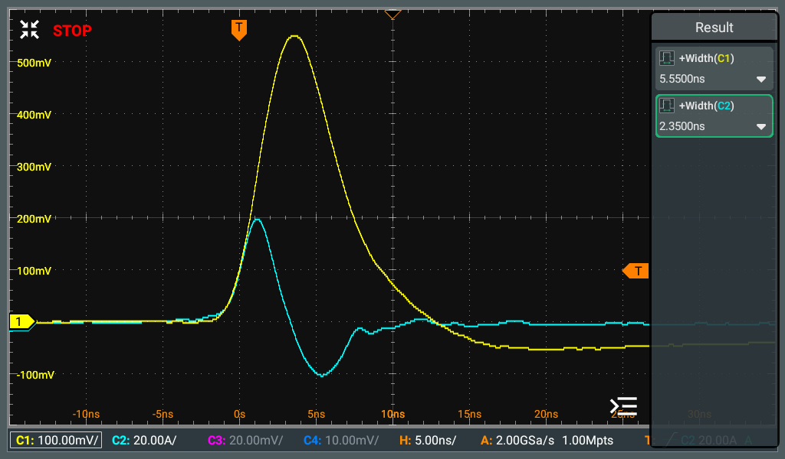 
    </td>
  </tr>
</table>

## Table of Contents

- [1. Technical Specification](#1-technical-specification)
  - [1.1 Key Features](#11-key-features)
  - [1.2 Design Specification](#12-design-specification)
  - [1.3 The MicroFC-30035 SiPM](#13-the-microfc-30035-sipm)
- [2. Circuit Design](#2-circuit-design)
  - [2.1 Overview](#21-overview)
  - [2.2 Input Protection](#22-input-protection)
  - [2.3 HV Power Supply](#23-hv-power-supply)
  - [2.4 LV Power Supply](#24-lv-power-supply)
  - [2.5 Photodetector](#25-photodetector)
  - [2.6 Amplifier](#26-amplifier)
  - [2.7 Temperature Sensor](#27-temperature-sensor)
- [3. PCB Layout](#3-pcb-layout)
  - [3.1 Physical Dimensions](#31-physical-dimensions)
  - [3.2 Peripheral Components](#32-peripheral-components)
  - [3.3 Assembled Detector Boards](#33-assembled-detector-boards)
- [4. Detector Performance](#4-detector-performance)
  - [4.1 Single Photon Detection](#41-single-photon-detection)
  - [4.2 Observing Nanosecond Light Pulses](#42-observing-nanosecond-light-pulses)
  - [4.3 Basic Time-of-Flight Experiments](#43-basic-time-of-flight-experiments)
  - [4.4 Thermal Performance, Active Cooling and Dark Count](#44-thermal-performance-active-cooling-and-dark-count)
- [5. Mechanical Design](#5-mechanical-design)
  - [5.1 Active Cooling](#51-active-cooling)
- [6. References](#6-references)
  - [6.1 Datasheets of Main Components](#61-datasheets-of-main-components)
  - [6.2 Reference Documents](#62-reference-documents)
  - [6.3 Design Tools](#63-design-tools)

## 1. Technical Specification

### 1.1 Key Features

This detector board is built around the [MicroFC-30035](https://www.onsemi.com/pub/Collateral/MICROC-SERIES-D.PDF) SiPM and uses its fast output for readout.
The fast output is amplified by a [GALI-S66+](https://www.minicircuits.com/pdfs/GALI-S66+.pdf) RF amplifier.
The SiPM bias voltage is generated by an integrated [LT8365](https://www.analog.com/media/en/technical-documentation/data-sheets/lt8365.pdf) boost converter followed by an adjustable low-noise LDO and can be adjusted from $23.8\ \mathrm{V}$ to $29.1\ \mathrm{V}$.
Separate high-voltage and low-voltage power rails are created on board from a single input voltage.

An [MCP9700A](https://ww1.microchip.com/downloads/en/devicedoc/20001942g.pdf) analog temperature sensor is also included on the board to enable external temperature control.

### 1.2 Design Specification

| Parameter | Value |
|-|-|
| Input Voltage | $7.5\ \mathrm{V}$ to $24\ \mathrm{V}$ |
| SiPM | onsemi MicroFC-30035 |
| SiPM Bias Adjustment | $23.8\ \mathrm{V}$ to $29.1\ \mathrm{V}$ |
| Amplifier | GALI-S66+ |
| Fast-Output Amplification | $+20.3\ \mathrm{dB}$ @ $1\ \mathrm{GHz}$ (typ.) |
| Amplifier Output | Voltage readout, $50\ \Omega$ matched |
| Temperature Sensor | MCP9700A with analog output |
| Input Protection | Reverse voltage protection   Short-circuit protection |

> ℹ️ The lower input voltage limit is set by the undervoltage shutdown of the high-voltage supply. Refer to [2.3](#23-hv-power-supply).

> ℹ️ The MicroFC-30035 datasheet specifies a breakdown voltage of $24.2\ \mathrm{V}$ to $24.7\ \mathrm{V}$ and a recommended overvoltage of $1\ \mathrm{V}$ to $5\ \mathrm{V}$.
> The upper bias limit of $29.1\ \mathrm{V}$ corresponds to an overvoltage of $4.4\ \mathrm{V}$ to $4.9\ \mathrm{V}$.
> The lower bias limit of $23.8\ \mathrm{V}$ is below the breakdown voltage.

### 1.3 The MicroFC-30035 SiPM

The MicroFC-30035 was chosen for this project because of its unique fast output.

The fast output of the MicroFC-30035 has a rise time of $600\ \mathrm{ps}$ and is well suited for timing experiments and for observing fast transients.
The electronic readout and amplification of the fast output are also very simple.
Because it is a direct voltage output, it can be amplified with standard wideband RF amplifiers.

The MicroFC-30035 is sensitive to blue light and has its peak sensitivity at $420\ \mathrm{nm}$.

  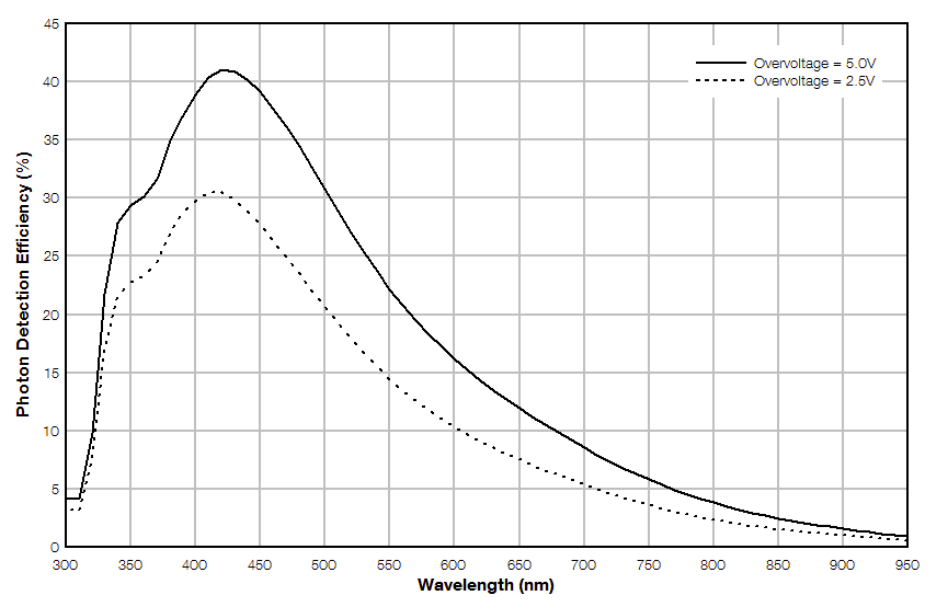 
  
Photon Detection Efficiency (PDE) of the MicroFC-30035 (<a href="https://www.onsemi.com/pub/Collateral/MICROC-SERIES-D.PDF">Datasheet p. 7</a>)

## 2. Circuit Design

### 2.1 Overview

  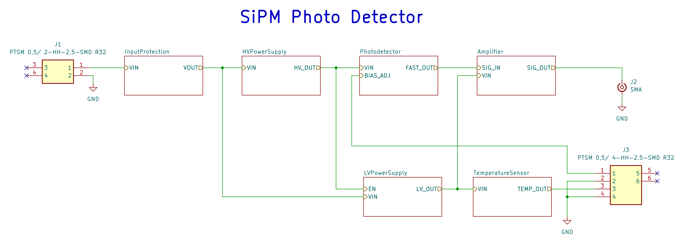 

The complete schematic is available [here](01_Docs/02_Schematic/sipm_photo_detector_v0_2.pdf) as a PDF.

The MicroFC-30035 is the main component of this detector board, and the entire circuit is designed to maximize its performance through:
- heavy filtering on the SiPM and amplifier supply rails
- $50\ \Omega$ matched transmission lines and high-frequency RF components
- EMI shielding

### 2.2 Input Protection

  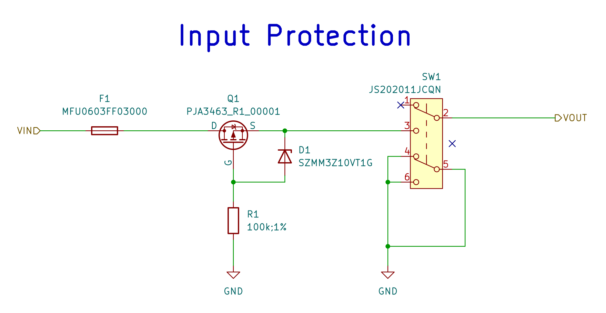 

The detector is protected against reverse input voltages through MOSFET $\mathrm{Q1}$.
Additionally, the input stage includes the SMD fuse $\mathrm{F1}$ for short-circuit protection.
The detector can be physically turned on and off by switch $\mathrm{SW1}$.

There are no power indicator LEDs on the board to avoid interference with the sensor.

### 2.3 HV Power Supply

  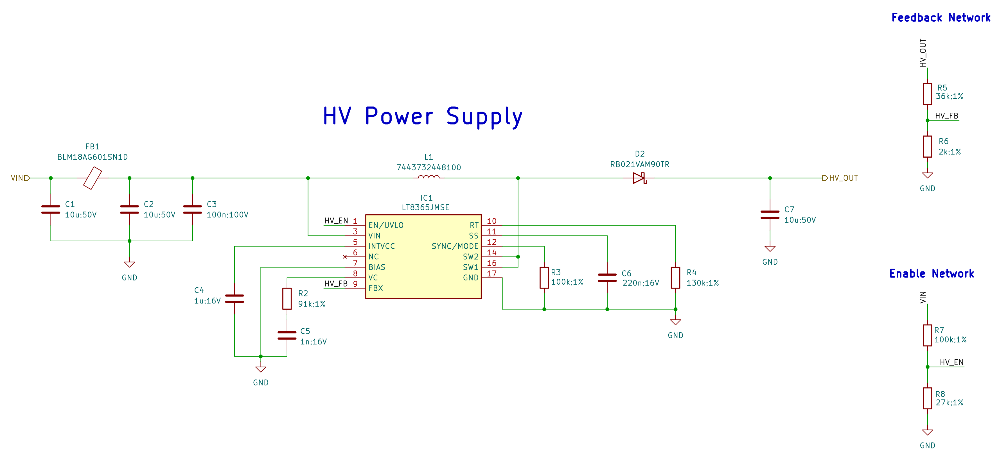 

The high-voltage rail is exclusively used to supply the SiPM bias voltage.
It is generated with the LT8365 boost converter $\mathrm{IC1}$ and is set to $30.4\ \mathrm{V}$ by the feedback resistors $\mathrm{R5}$ and $\mathrm{R6}$.
The converter input is filtered by the ferrite bead $\mathrm{FB1}$ and the surrounding capacitors.

The high-voltage regulator shuts down when the input voltage falls below $7.5\ \mathrm{V}$.
This undervoltage threshold is set by the enable network formed by $\mathrm{R7}$ and $\mathrm{R8}$.

### 2.4 LV Power Supply

  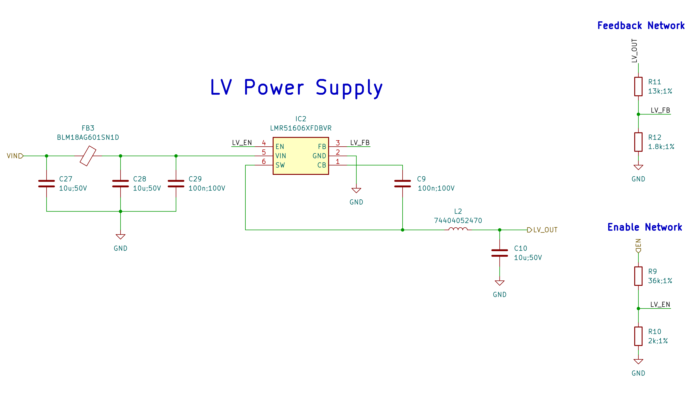 

The low-voltage supply uses the LMR51606 buck converter $\mathrm{IC2}$ to generate a fixed $6.6\ \mathrm{V}$ rail.
The output voltage is set by the feedback network formed by $\mathrm{R11}$ and $\mathrm{R12}$.
The converter input is filtered by the ferrite bead $\mathrm{FB3}$ and the surrounding capacitors.

The enable network formed by $\mathrm{R9}$ and $\mathrm{R10}$ monitors the high-voltage rail and turns the converter on at approximately $23.3\ \mathrm{V}$.
The low-voltage rail therefore only turns on once the high-voltage supply has stabilized.

The output voltage is set as high as possible for the minimum input voltage of $7.5\ \mathrm{V}$ to improve amplifier performance.

### 2.5 Photodetector

  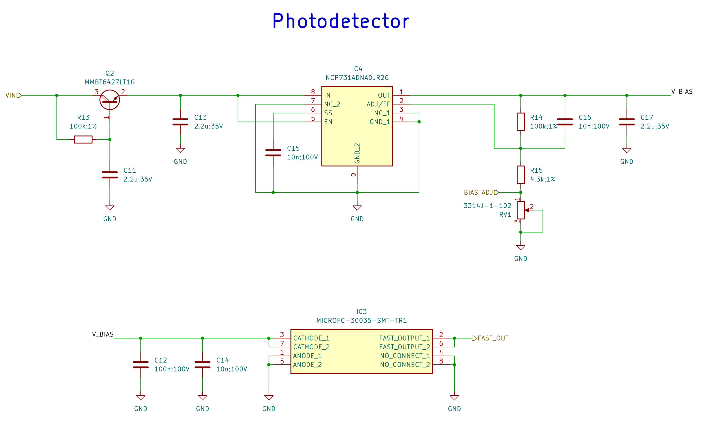 

The HV supply rail is filtered with a capacitance multiplier stage that is built with the Darlington transistor $\mathrm{Q2}$ to minimize supply ripple from the LT8365 converter.
The filtered voltage is then reduced further with the adjustable low-noise LDO $\mathrm{IC4}$ to precisely set the SiPM bias voltage.
The bias voltage is continuously adjustable from $23.8\ \mathrm{V}$ to $29.1\ \mathrm{V}$ with the on-board potentiometer $\mathrm{RV1}$.

It is possible to override the on-board potentiometer with an external one for use cases where the detector is integrated into a larger assembly.
To keep the circuit simple, the external potentiometer is connected in parallel with $\mathrm{RV1}$.
Therefore, when using an external potentiometer, the on-board potentiometer must be set to its **highest resistance** to produce the **minimum bias voltage**.
The output voltage can then be adjusted with a high-resistance external potentiometer connected between `BIAS_ADJ` (CONN2 pin 1) and `GND` (CONN2 pin 2).
An external potentiometer with a resistance of at least $100\ \mathrm{k}\Omega$ is recommended to preserve the full voltage adjustment range.

> ℹ️ The MicroFC application note [AND9782-D](https://www.onsemi.com/pub/Collateral/AND9782-D.PDF) recommends using a negative bias on the anode, with the cathode at $0\ \mathrm{V}$, for the best fast-output timing performance of this SiPM.
> Currently, a positive supply rail is used, but the LT8365 can be configured to generate a negative voltage instead.
> In this case, the adjustable LDO would need to be replaced with a negative-voltage version.

### 2.6 Amplifier

  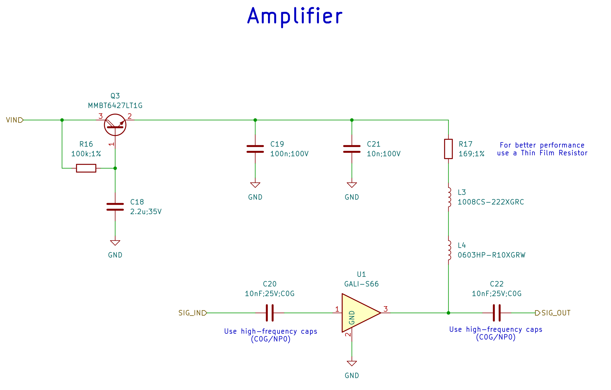 

The fast-output signal is amplified by the GALI-S66+ RF amplifier $\mathrm{U1}$.
This stage is critical to detector performance and is laid out as a dedicated high-frequency signal path with an optional shielding can.
The high-frequency path uses $50\ \Omega$ transmission lines and C0G/NP0 capacitors for improved performance.
The amplifier's bias tee uses two RF inductors of different sizes, $\mathrm{L3}$ and $\mathrm{L4}$, for good performance over a wide frequency range.

A second capacitance multiplier stage with the Darlington transistor $\mathrm{Q3}$, similar to the one in the SiPM bias supply, is used to filter the amplifier voltage rail.

### 2.7 Temperature Sensor

  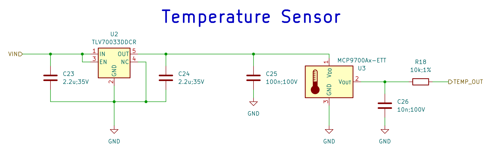 

The local $3.3\ \mathrm{V}$ LDO $\mathrm{U2}$ powers the MCP9700A temperature sensor $\mathrm{U3}$ from the low-voltage rail.
The MCP9700A outputs an analog voltage that changes linearly with the sensor temperature.
The temperature sensor output is filtered with the small capacitor $\mathrm{C26}$ and protected by the series resistor $\mathrm{R18}$ to prevent damage in case the output pin is accidentally shorted.

> ℹ️ The [MCP9700A datasheet](https://ww1.microchip.com/downloads/en/devicedoc/20001942g.pdf) specifies a typical output voltage of $500\ \mathrm{mV}$ at $T_A=0\ \mathrm{^\circ C}$ and a temperature coefficient of $T_C=10\ \mathrm{mV/^\circ C}$.
> The sensor temperature can therefore be calculated as $T_A=(U_{out} - 0.5\ \mathrm{V}) \cdot 100 \frac{\mathrm{^\circ C}}{\mathrm{V}}$.
> Refer to the MCP9700A datasheet for more information on sensor readout and accuracy.

> ℹ️ The temperature sensor is provided as an auxiliary feature to support an external temperature controller.
> The detector board does not include the controller's power electronics for the following reasons:
> - A linear controller is recommended over a switching controller to protect the sensitive detector circuit from switching noise.
> - Linear controllers dissipate significant power and generate heat.
> - This heat must be kept away from the SiPM. Otherwise, it would counteract the active cooling.
>
> For these reasons, the temperature controller is to be implemented externally.

## 3. PCB Layout

### 3.1 Physical Dimensions

The V0.2 PCB measures $60\ \mathrm{mm} \times 40\ \mathrm{mm}$ and has an M3 hole pattern of $50\ \mathrm{mm} \times 30\ \mathrm{mm}$.

The PCB is laid out around the central MicroFC-30035.
Care has been taken to keep switching signals away from the sensor and amplifier, and a four-layer PCB stackup has been chosen for better EMI performance.
Additionally, the amplifier stage is designed to fit inside a $10\ \mathrm{mm} \times 15\ \mathrm{mm}$ clip-on metal shielding can.

The center of the bottom layer of the PCB is intentionally kept free of components and THT holes to allow a $40\ \mathrm{mm} \times 40\ \mathrm{mm}$ thermoelectric cooler to be mounted directly below the sensor.

  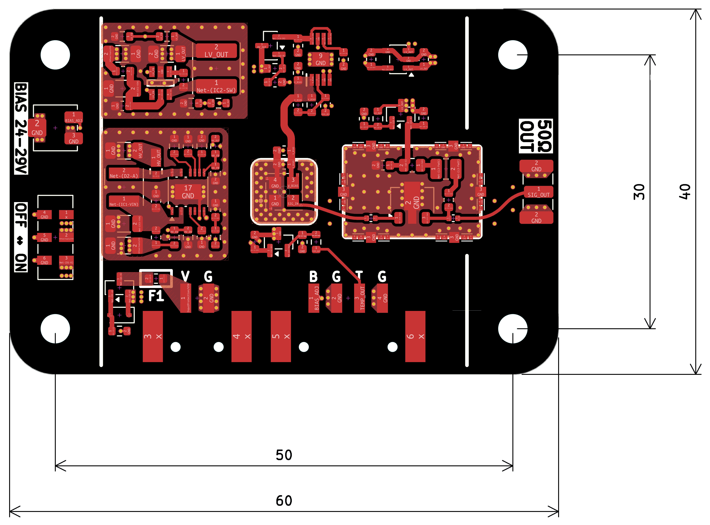 

### 3.2 Peripheral Components

Below is a functional description of the main peripheral components of the PCB.

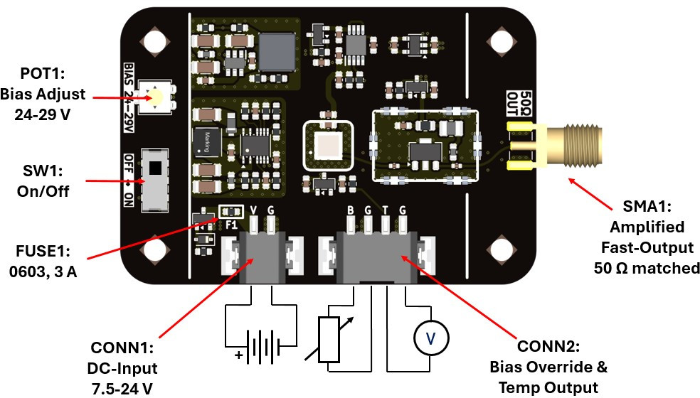 

| Reference | Description |
|-|-|
| SW1   | On/off switch. Switches the input voltage. |
| POT1  | Bias voltage adjustment. |
| SMA1  | Amplified fast output of the SiPM ($50\ \Omega$). |
| CONN1 | DC input. $7.5\ \mathrm{V}$ to $24\ \mathrm{V}$. Pin order: `V`, `G`. Mating plug: [PTSM 0,5/ 2-P-2,5](https://www.phoenixcontact.com/en-de/products/pcb-connector-ptsm-05-2-p-25-1778832). |
| CONN2 | External bias override and analog temperature output, each with its own ground pin. Pin order: `B` (`BIAS_ADJ`), `G`, `T` (`TEMP_OUT`), `G`. Mating plug: [PTSM 0,5/ 4-P-2,5](https://www.phoenixcontact.com/en-de/products/pcb-connector-ptsm-05-4-p-25-1778858). |
| FUSE1 | 0603 SMD fuse ($3\ \mathrm{A}$) for short-circuit protection. |

> ℹ️ The connectors on the board are the PTSM 0,5/ 2-HH-2,5-SMD R32 (CONN1) and PTSM 0,5/ 4-HH-2,5-SMD R32 (CONN2) headers.

### 3.3 Assembled Detector Boards

The front and back of the assembled Fast SiPM Photodetector V0.2 PCB are shown below.
Two board were assembled for performance testing.

  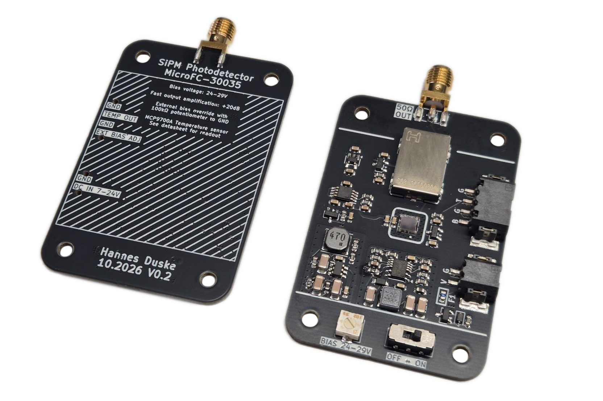 
  
Front and back side of the assembled Fast SiPM Photodetector V0.2 PCB.

## 4. Detector Performance

### 4.1 Single Photon Detection

### 4.2 Observing Nanosecond Light Pulses

The unique fast output of the MicroFC series makes this detector perfectly suited for observing nanosecond-scale light pulses.
As an example, the light responses of a generic blue LED and an ams OSRAM PLPT9 450LC_E laser diode were measured while pulsing each source with [this Avalanche Laser Driver](https://github.com/hannesduske/Avalanche_Laser_Driver).

   
  
Experimental setup with an avalanche diode driver on the left, a stack of ND filters in the middle and the Fast SiPM Photodetector V0.2 on the right.

> ℹ️ The SiPM detector is too sensitive to measure either of the tested light sources directly at the tested operating conditions.
> A stack of ND8, ND64 and ND1000 neutral-density filters, with a combined attenuation of $512000$, was placed between the source and the detector for these measurements.

In the figures below, the cyan trace is the drive-current pulse and the yellow trace is the SiPM output.
The scope's pulse-width measurements show a drive-current width of $2.05\ \mathrm{ns}$ and a detector-output width of $5.55\ \mathrm{ns}$ for the blue LED.
For the PLPT9 laser diode, the corresponding widths are $2.35\ \mathrm{ns}$ and $4.30\ \mathrm{ns}$ for the main optical pulse.
These measurements show the detector's response to the emitted light, but do not provide an absolute optical power or energy measurement.
If an additional optical power measurement was available, the measured pulse shape and pulse frequency can be used to estimate the peak optical power.

The additional peaks in the laser-diode response coincide with oscillations visible in the drive-current trace.
These are likely caused by the reverse-protection Zener diode that is integrated into the PLPT9 package.
This Zener diode provides a reverse-current path that allows energy stored in the driver capacitor to oscillate with the parasitic inductance of the driver output stage, producing the observed ringing.

The droop following each positive pulse is caused by the high-pass response of the capacitively coupled fast output and the amplifier's DC-blocking capacitors.
Using high-quality RF capacitors instead of the previously tested C0G capacitors of PCB version V0.1 significantly reduced this droop, but it remains visible in these measurements.

<table style="border-collapse: collapse; border: none;">
    <tr>
        <td style="border: none; text-align: center;">
             
            
Drive-current pulse (cyan) through a generic blue LED and the measured SiPM output (yellow).

        </td>
        <td style="border: none; text-align: center;">
            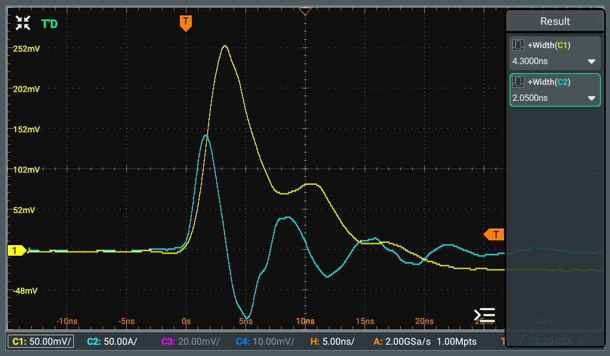 
            
Drive-current pulse (cyan) through a PLPT9 450LC_E laser diode and the measured SiPM output (yellow).

        </td>
    </tr>
</table>

> ℹ️ The MicroFC-30035 fast output pulses always have a positive polarity regardless of how the device is biased.
> Note that the on-board RF amplifier inverts the pulse polarity, resulting in **negative-going pulses** at the PCB's SMA output.
> An additional external amplifier between the detector board and oscilloscope would invert the signal polarity again.
> To get positive pulse shapes in the above example, the SiPM output traces were inverted by the scope.

### 4.3 Basic Time-of-Flight Experiments

### 4.4 Thermal Performance, Active Cooling and Dark Count

#### Bias Voltage and Dark Count

SiPM dark-count rate and dark current increase with temperature and overvoltage, as shown in the left-hand plot from the MicroFC datasheet.
The plot shows the dark current of the larger $6\ \mathrm{mm} \times 6\ \mathrm{mm}$ MicroFC-60035 sensor.
Its absolute values therefore differ from those of the MicroFC-30035, but the general trends are similar.

<table style="border-collapse: collapse; border: none;">
    <tr>
        <td style="border: none; text-align: center;">
            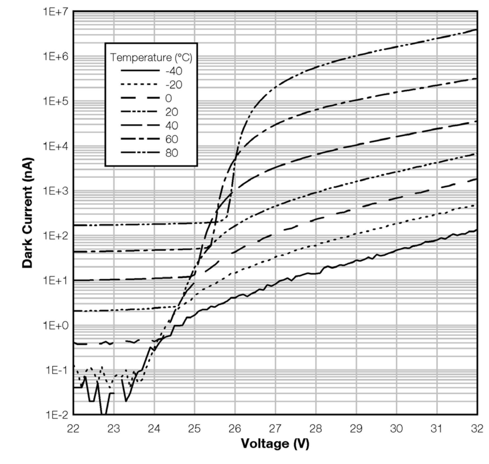 
            
Dark current versus voltage and temperature of the MicroFC-60035 (<a href="https://www.onsemi.com/pub/Collateral/MICROC-SERIES-D.PDF">Datasheet p. 8</a>)

        </td>
        <td style="border: none; text-align: center;">
            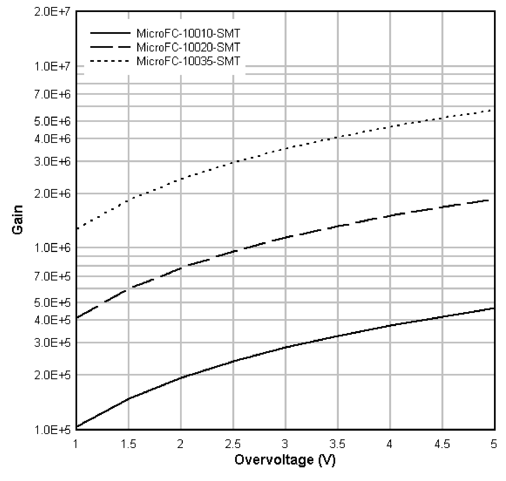 
            
Gain versus voltage of the MicroFC family (<a href="https://www.onsemi.com/pub/Collateral/MICROC-SERIES-D.PDF">Datasheet p. 8</a>)

        </td>
    </tr>
</table>

The voltage and temperature dependence of dark-count rate poses an inherent challenge for high-sensitivity applications.
These applications require high gain, which is achieved by increasing the SiPM's overvoltage, while also requiring a low dark-count rate.
The plots show that reducing the temperature lowers the dark current, while the gain is primarily determined by overvoltage.
In practice, this makes thermal management important.
This design addresses it through careful thermal layout and optional active temperature control.

#### Thermal Layout of the Detector PCB

The first iteration of the detector PCB had slots milled around the SiPM to thermally isolate it from the surrounding components.
This turned out to be a poor design choice because the SiPM itself generates more heat than any other component.
The slots did not isolate the SiPM from heat generated by other components but prevented it from dissipating its own heat, resulting in a higher sensor temperature.
In the second iteration, the slots were removed and replaced with a copper pour around the SiPM, with many vias connecting it thermally to the copper planes on the three lower PCB layers.

The thermal images below show the improved thermal layout of V0.2.
At the same bias voltage and after the same operating time, the sensor hotspot reading decreased by $5.9\ \mathrm{^\circ C}$.
Both detectors were set to a bias voltage of $25.1\ \mathrm{V}$, and no external heat sink or cooler was attached to the bottom of either PCB.

<table style="border-collapse: collapse; border: none;">
    <tr>
        <td style="border: none; text-align: center;">
            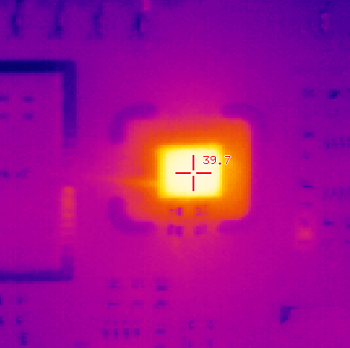 
            
PCB V0.1: 39.7 °C

        </td>
        <td style="border: none; text-align: center;">
            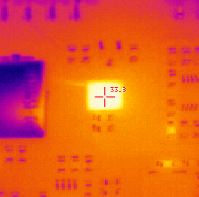 
            
PCB V0.2: 33.8 °C

        </td>
    </tr>
</table>

The following thermal images of the second PCB version were taken 1 second, 30 seconds, 1 minute and 5 minutes after power-on.
They show the SiPM as the main local heat source and the improved thermal coupling between the sensor and the PCB, which helps spread the heat.
The detector was operated at a constant bias voltage of $25.1\ \mathrm{V}$, with no external heat sink or cooler attached to the bottom of the PCB.

<table style="border-collapse: collapse; border: none;">
    <tr>
        <td style="border: none; text-align: center;">
            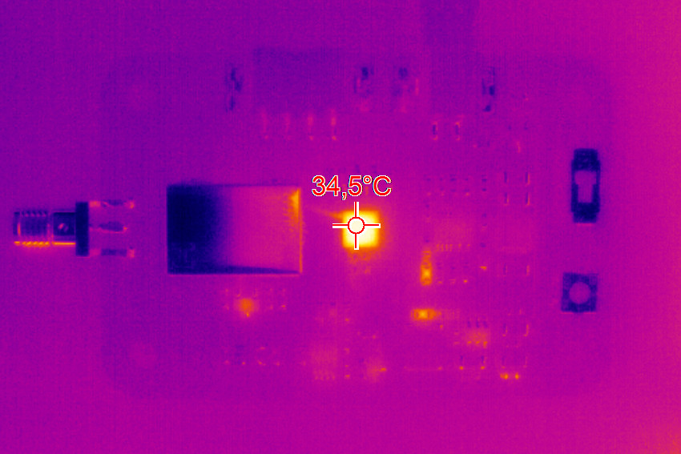 
            
1 second after power-on

        </td>
        <td style="border: none; text-align: center;">
            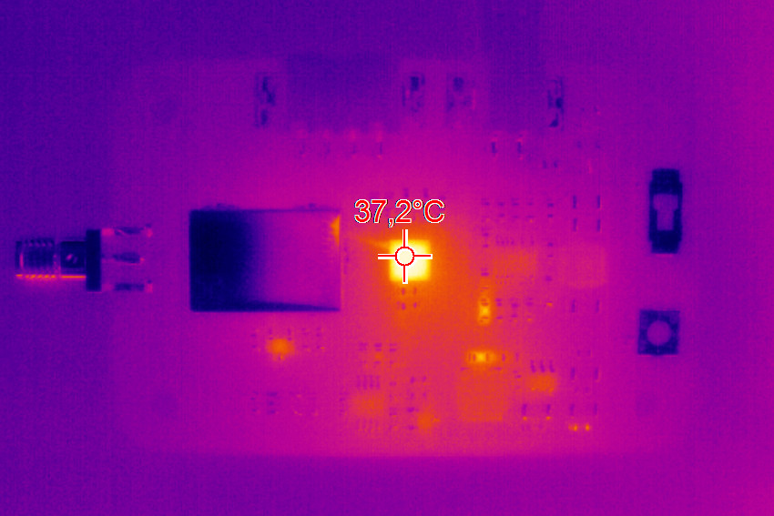 
            
30 seconds after power-on

        </td>
    </tr>
    <tr>
        <td style="border: none; text-align: center;">
            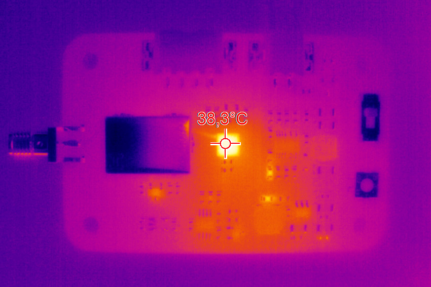 
            
1 minute after power-on

        </td>
        <td style="border: none; text-align: center;">
            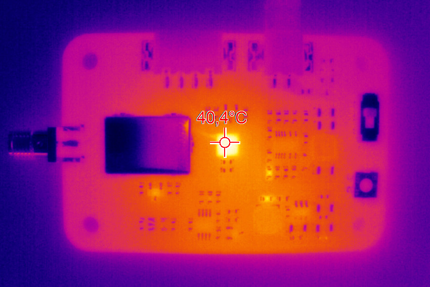 
            
5 minutes after power-on

        </td>
    </tr>
</table>

#### Active Cooling

#### Measured Dark Count

## 5. Mechanical Design

### 5.1 Active Cooling

## 6. References
### 6.1 Datasheets of Main Components
- [MicroFC-30035](https://www.onsemi.com/pub/Collateral/MICROC-SERIES-D.PDF) Silicon photomultiplier
- [NCP731](https://www.onsemi.com/pub/Collateral/NCP731-D.PDF) Low-noise LDO
- [LT8365](https://www.analog.com/media/en/technical-documentation/data-sheets/lt8365.pdf) Boost converter
- [LMR51606](https://www.ti.com/lit/ds/symlink/lmr51606.pdf) Buck converter
- [TLV70033](https://www.ti.com/lit/ds/symlink/tlv700.pdf) LDO
- [GALI-S66+](https://www.minicircuits.com/pdfs/GALI-S66+.pdf) RF amplifier
- [MCP9700A](https://ww1.microchip.com/downloads/en/devicedoc/20001942g.pdf) Temperature sensor

### 6.2 Reference Documents
- [AND9770-D](https://www.onsemi.com/pub/Collateral/AND9770-D.PDF) Introduction to the Silicon Photomultiplier (SiPM)
- [AND9782-D](https://www.onsemi.com/pub/Collateral/AND9782-D.PDF) Biasing and Readout of SiPM Sensors
- [AND9787-D](https://www.onsemi.com/pub/Collateral/AND9787-D.PDF) SiPM SMA Board Experiment Guide
- [AND9809-D](https://www.onsemi.com/pub/Collateral/AND9809-D.PDF) Reference Designs for the SMA and SMTPA MLP-Packaged SiPM Evaluation Boards

### 6.3 Design Tools
- [LTSpice](https://www.analog.com/en/resources/design-tools-and-calculators/ltspice-simulator.html) Circuit simulation
- [KiCad 10](https://www.kicad.org/blog/2026/03/Version-10.0.0-Released/) Circuit board design
- [SMath Studio](https://smath.com/) Design calculations

## License

This project is licensed under the CERN Open Hardware Licence Version 2 - Permissive ([CERN-OHL-P](https://ohwr.org/cern_ohl_p_v2.txt)).

Third-party datasheets, logos, and referenced documentation remain the property of their respective owners.
